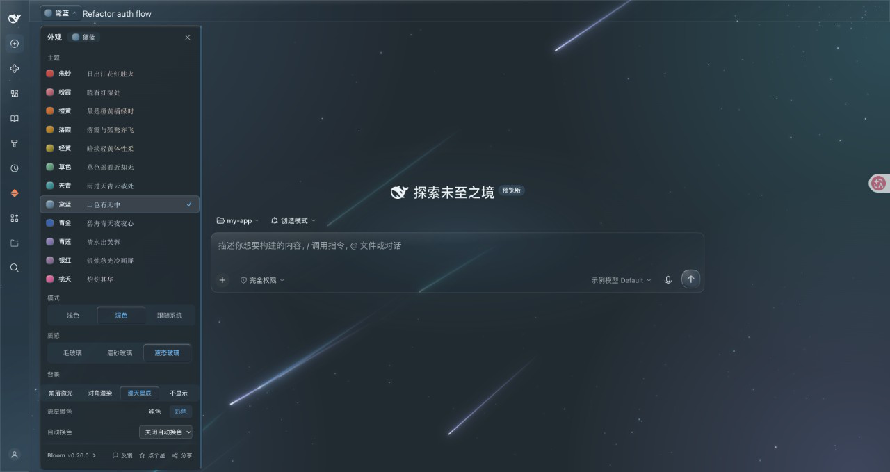

  

<h1 align="center">🌊 Bloom for DSH</h1>

<strong>Give DeepSeek Harness a beautiful glass theme.</strong> Morandi palettes · three glass materials · living backgrounds

  
  
  
  
  
  
  

<a href="README.md">中文</a> · <a href="https://github.com/webkubor/dsh-bloom-theme">⭐ Star it if you like it</a>

<!-- demo-video -->

[▶ 27-second demo: switch palettes, glass, starry sky](https://raw.githubusercontent.com/webkubor/dsh-bloom-theme/4bf1fb879cfef52eee54aa52a1e11d07375054b5/assets/showcase/v0.27.0/bloom-demo-v0.27.0.mp4)

### Beautiful and practical

| 🎨 A palette for every mood | 🪟 Pick your glass | ✨ Watercolour days, starry nights |
| :-- | :-- | :-- |
| Cinnabar, Lotus, Mist… Chinese-poetry Morandi palettes; the whole UI and background change together | Liquid, frosted or matte glass, one click to switch | Dark and light backgrounds are remembered separately; meteors glow at night while light mode washes watercolour from your palette |

### Install

Search **`dsh-bloom-theme`** in DeepSeek Harness "Plugins", install, and restart when prompted. Then click the theme button in the top bar and start matching.

Like Bloom? [Leave a ⭐ Star](https://github.com/webkubor/dsh-bloom-theme) so more people find it, and share your palette.

Demo recorded in DSH Web with a redacted example session. Screenshot and recording features depend on host support; if the desktop picker cannot open, use your system capture tools.

[Issues](https://github.com/webkubor/dsh-bloom-theme/issues) · [Changelog](CHANGELOG.md) · [MIT License](LICENSE) · Palette origins: [typora-Bloom-theme](https://github.com/webkubor/typora-Bloom-theme)
