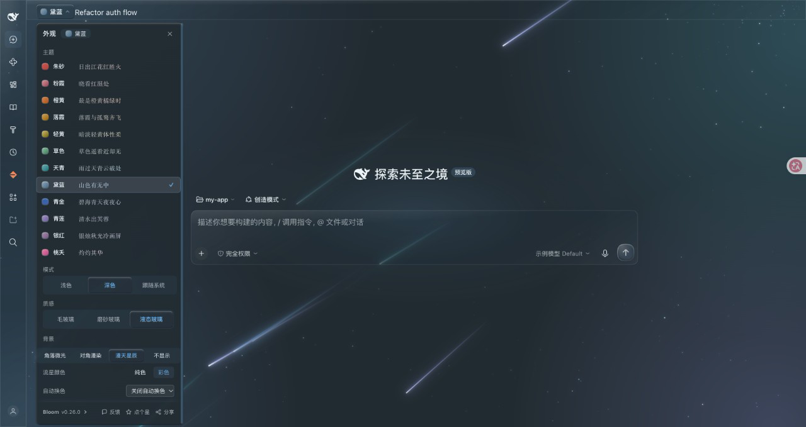

  

<h1 align="center">🌊 Bloom for DSH</h1>

  <strong>给 DeepSeek Harness 的玻璃质感主题 —— 12 套莫兰迪配色 · 三种玻璃 · 会流动的背景</strong>

  
  
  

<!-- demo-video -->

## 先看效果

[▶ 观看完整演示：配色 · 材质 · 明暗背景（27 秒，无声音）](https://raw.githubusercontent.com/webkubor/dsh-bloom-theme/v0.27.0/assets/showcase/v0.27.0/bloom-demo-v0.27.0.mp4)

来自 DSH Web 实际界面的脱敏演示会话：画面里的项目、会话与模型均为示例。深色背景为「漫天星辰」。

**深浅两套氛围，各自独立设置：**

| 深色 · 漫天星辰 | 浅色 · 水彩晕染 |
| :--: | :--: |
| 深色下流星从右上角划过，换配色时正在飞的流星保留旧色，新落下的才是新色 | 浅色以当前皮肤主色 + 两个协调色晕开，自然散到纯白 |

**三种玻璃质感，随时切换：**

| 液态玻璃 | 磨砂玻璃 | 毛玻璃 |
| :--: | :--: | :--: |
| 边缘有真实折射，光会拐弯 | 透光带细颗粒 | 经典半透模糊 |

**发送按钮是一颗随皮肤变色的玻璃珠** —— 朱砂皮肤下是暖红，草色皮肤下是青绿，不再固定蓝色。

## 30 秒装好

在 DSH 应用里点开「插件」管理，搜 `dsh-bloom-theme`，安装，按提示重启。装完顶栏会多一个「黛蓝 ▾」按钮，点它：

- **主题**：12 套精选莫兰迪配色
- **质感**：液态玻璃 / 磨砂玻璃 / 毛玻璃
- **背景**：深色、浅色各自独立选
- **分享**：一键复制安装提示词发给 Agent；截图与 5 秒录屏依宿主支持，当前桌面端实测无法打开选择器，可使用系统截图／录屏

## 这是什么

一句话：**让你的 DeepSeek Harness 变好看。**

- 🎨 **12 套中国风莫兰迪配色**，朱砂、桃夭、天青、青莲……每套都有明暗两版
- 🪟 **真玻璃，不是贴图**：侧栏、顶栏、输入卡、控制区统一材质，透明度和模糊实时跟随背后的内容
- ✨ **背景会动**：深色有对角漫染、漫天星辰、角落微光；浅色有斜光流转、水彩晕染、清透留白
- 🌗 **深浅各自独立**：晚上开流星，白天开水彩，互不干扰
- ♿ **尊重系统设置**：高对比度、减少动效、减少透明度自动降级

## 觉得好用？

开源不易，持续维护更不容易。如果 Bloom 让你的 DSH 每天都舒服一点：

- ⭐ 去 [仓库首页](https://github.com/webkubor/dsh-bloom-theme) 点个 Star —— 这是我继续做下去的最大动力
- 📤 菜单里点「分享」，把安装提示词发给朋友，或截一张你的界面晒出来

## 界面截图

> 本版深色「漫天星辰」画面，来自已脱敏的 DSH Web 演示会话。

## 常见问题

**主题没生效？** 在插件管理里确认包已启用；若提示需要重启，完成应用重启再看。仍异常请提 [issue](https://github.com/webkubor/dsh-bloom-theme/issues)。

**截图/录屏点了没反应？** 截图和录制走系统屏幕选择器，需要你手动选择要分享的屏幕/窗口/标签页，且不会录声音。桌面端支持情况依宿主而定，失败会有明确提示。

**隐私？** 主题只在本地运行；截图和录屏只在你点击时发起、只存在本地，由你自己决定发不发。匿名点击统计可在面板里一键关闭。

## 支持

如果 Bloom 让你的 DSH 用起来更舒服，欢迎留下一颗 ⭐，或请我喝杯咖啡（[Sponsor](https://github.com/sponsors/webkubor)）。

## License

[MIT](LICENSE) — 配色源自 [typora-Bloom-theme](https://github.com/webkubor/typora-Bloom-theme)。
